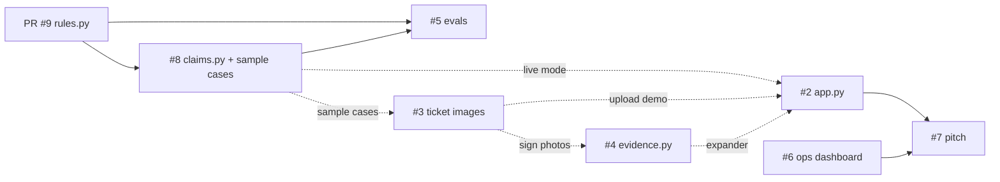

# ParkRefund — "AirHelp for parking fines in Denmark"

*Hackathon build, Claude Impact Lab Copenhagen, 21 Oct 2026. Theme: "What does AI mean for my job?"*

## The idea in one paragraph

AirHelp made a business out of flight-delay compensation: you give them the claim, they tell you
if it's worth fighting, they fight it, and they only take a cut if you win. We do the same for
parking fines in Denmark. A fine is 510–1,020 DKK (kommune) or 650–900 DKK (private operator).
Most people pay even when they'd win on appeal, because the appeal is tedious and they don't
know the rules. ParkRefund: upload the ticket, tell us what happened, get an **honest** verdict on
your odds, a ready-to-send Danish appeal letter, and pay a 30% success fee only if the money comes back.

**The job angle (what the judges care about):** the work this automates is the junior
paralegal's — triaging hundreds of small claims and writing boilerplate appeals. The ops
dashboard shows what the human's job becomes: reviewing only the borderline cases (40–60%
odds), overriding the model, and owning the filing. Model drafts and recommends; a human files.

## The user journey (what the demo shows)

1. **Landing** — hero + "no win, no fee" + demo stats.
2. **Intake** — upload a ticket photo (Claude vision prefills the form) or pick a sample case; fill in
   "what happened" and tick the evidence you have.
3. **Verdict** — probability of winning, strong/medium/weak, the grounds that help, the weaknesses,
   the evidence that would raise the odds, who to appeal to and by when. If it's weak we say
   "we wouldn't take this case" — that honesty is the trust moment of the demo.
4. **Letter** — the appeal ("indsigelse") in Danish (or English), downloadable.
5. **Payout** — refund, our fee, what you get.
6. **Ops dashboard** (separate page) — the paralegal's queue: KPIs, model verdict vs. real
   outcomes, the 40–60% review band with human decisions.

## Architecture

Streamlit app, Python in `.venv`, Anthropic SDK. No frameworks beyond that (see `CLAUDE.md`).

```
rules.py                 simplified Danish parking rulebook (grounding text) + SUCCESS_FEE     DONE (v1)   PR #9
claims.py                Claude layer: extract_ticket / assess_claim / draft_appeal + mock mode  IN PROGRESS issue #8
data/sample_cases.json   5 synthetic claims (ships with claims.py)                              IN PROGRESS issue #8
app.py                   Streamlit customer flow (steps 1–5 above)                              OPEN        issue #2
make_tickets.py          synthetic ticket images → data/tickets/*.png for the upload demo       OPEN        issue #3
evidence.py              vision check of the user's sign / car-position photos                  OPEN        issue #4
evals/                   ~15 labelled cases + runner: is the assessor calibrated to rules.py?   OPEN        issue #5
pages/1_Ops_dashboard.py the back-office view + data/pipeline.json (synthetic)                  OPEN        issue #6
PITCH.md                 2-minute pitch + click-by-click demo path                              OPEN        issue #7
```

Epic with everything linked: https://github.com/milo-dotcom/claude-impact-lab-cph/issues/1

### Build order



Solid = hard dependency. Dotted = needed for the demo, not to start — mock mode and the frozen
contract mean #2, #4 and #6 can begin immediately.

| Wave | When | Work |
|---|---|---|
| 0 | now | merge PR #9 |
| 1 | T+0 → T+45 | #8 claims.py · #2 app.py (mock) · #6 dashboard |
| 2 | T+45 → T+90 | #3 ticket images · #5 evals · #7 pitch draft · #2 wires live mode |
| 3 | T+90 → T+120 | #4 evidence (stretch) · #2 integrates #3/#4 · #7 final · first Opus run |
| — | T+120 | feature freeze, everything on `main` |
| — | T+150 | rehearsal ×2 (second with no `.env`) |

If wave 1 slips, cut wave 3 — never #2 or #6.

### Interface contract (`claims.py`)

Build against this now; don't wait for `claims.py` to land. In mock mode (no API key) every
function returns realistic deterministic output, so the UI and dashboard can be built and demoed
without a key.

```python
CLAIM_KEYS = ["issuer_type", "issuer_name", "ticket_number", "plate", "date", "time", "location",
              "amount_dkk", "reason_on_ticket", "driver_story", "evidence"]
# issuer_type: "public" (kommune) | "private" (operator)   amount_dkk: int
# date: "YYYY-MM-DD"   time: "HH:MM"   evidence: list[str]

def is_live() -> bool                                              # False → mock mode
def extract_ticket(image_bytes: bytes, media_type: str) -> dict    # partial claim dict from a ticket photo
def assess_claim(claim: dict) -> dict
#   {"success_probability": int 0-100, "verdict": "strong"|"medium"|"weak", "summary": str,
#    "grounds": [{"title": str, "strength": "strong"|"medium"|"weak", "explanation": str}],
#    "weaknesses": [str], "evidence_to_collect": [str], "route": str, "deadline_note": str,
#    "recommend_filing": bool}
def draft_appeal(claim: dict, assessment: dict, language: str = "da") -> str
def payout(amount_dkk: int) -> dict                                # {"refund", "fee", "you_get"}
```

`evidence.py` (issue #4) adds `check_evidence(images, claim) -> dict`; contract is in the issue.

## How to pick up work

1. Pick an open issue (#2–#7), comment "taking this" so nobody doubles up.
2. `git checkout -b parkrefund-<thing>` from `main` (or from `parkrefund-rules` if you need
   `rules.py` before PR #9 merges). **One owner per file** — if you need a change in someone
   else's file, comment on their issue instead of editing it.
3. Setup is in `README.md`. Run the app with `.venv/bin/streamlit run app.py`. No `.env` → mock mode.
4. Open a PR against `main` when it runs end to end. Ugly and working beats polished and partial.

## Conventions

- **Synthetic data only.** Invented operators ("NordPark ApS", "CityParkering A/S"), fictional
  kommuner ("Testkøbing Kommune"), fake plates ("AB 12 345"). No real companies, logos, or people.
- **Models / spend.** Default `claude-sonnet-5-5` everywhere. The env var `PARKREFUND_MODEL`
  switches to `claude-opus-5-5` for the demo run. Don't loop API calls; the evals set is ~15 cases.
- **Mock mode is not optional.** Anything that calls Claude must also work with no key, so we can
  demo on any laptop and survive an outage.
- **The rulebook is the source of truth** for what the assessor may claim. It's a simplified
  approximation (`rules.py`, not legal advice). If the model and the rulebook disagree, fix the
  prompt or the rulebook — don't special-case the UI.
- **The model drafts and recommends; a human files.** Keep that line in the UI copy and the pitch.

## Out of scope today

Real filing with operators/kommuner, payments, accounts, real legal review, anything with real PII.
Mention them as "next steps" in the pitch (issue #7).
