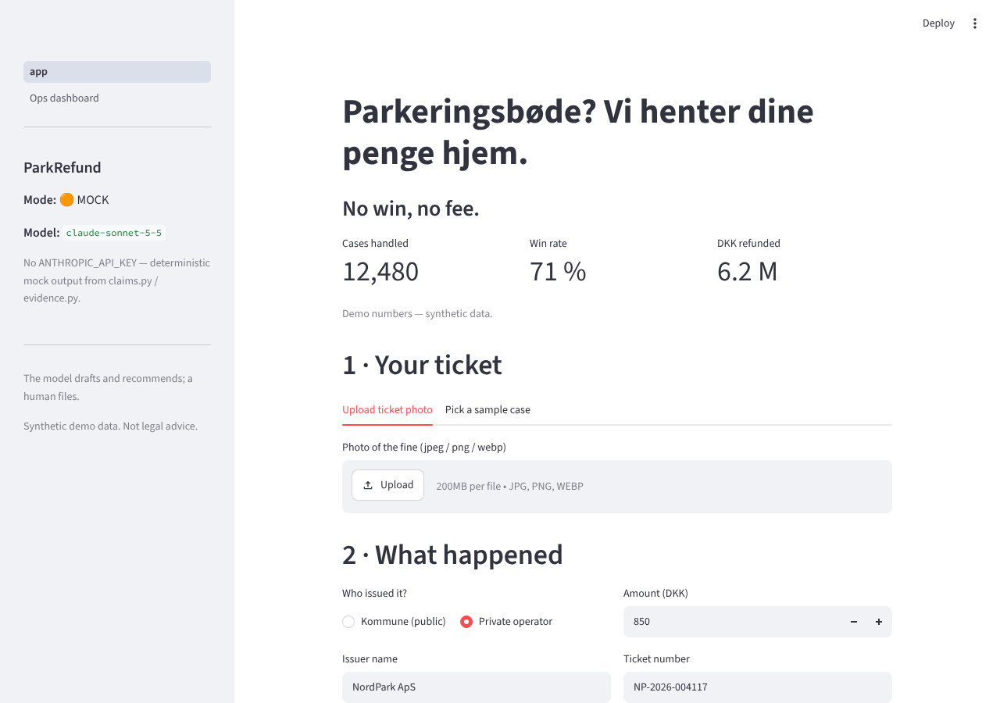
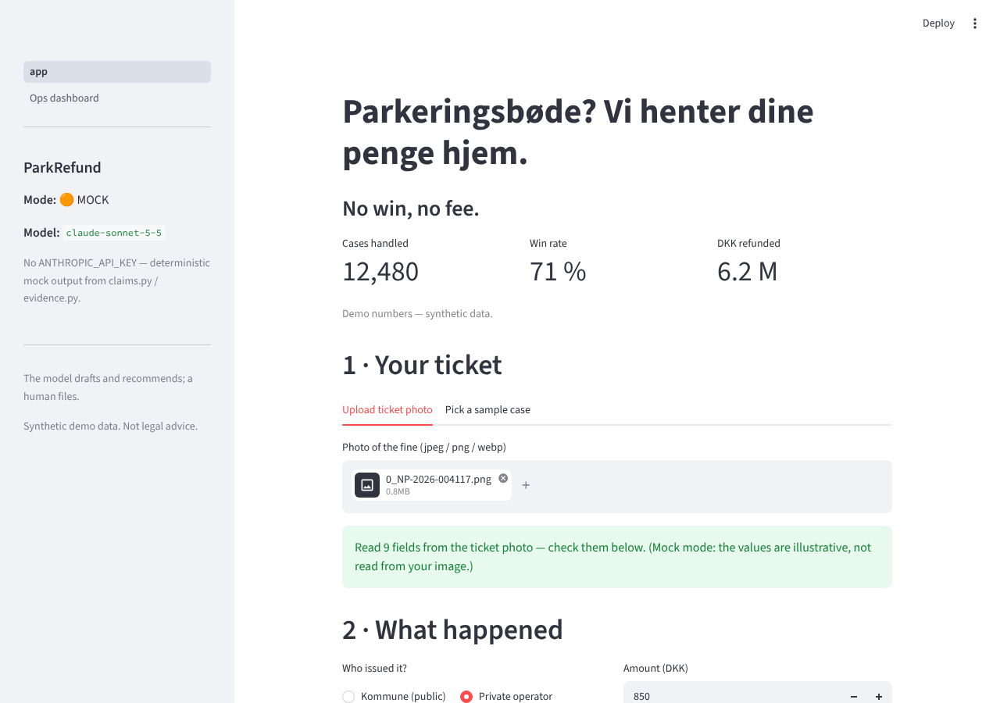
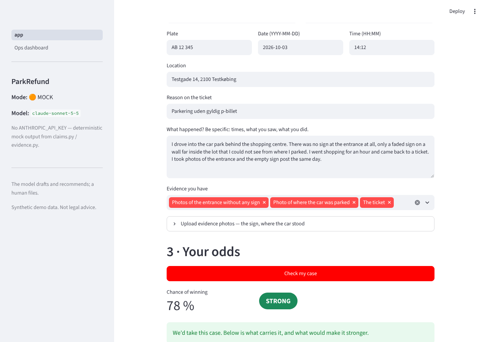
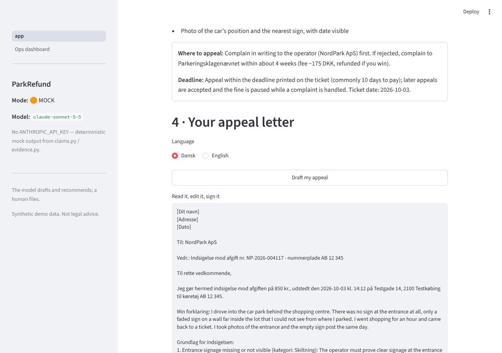
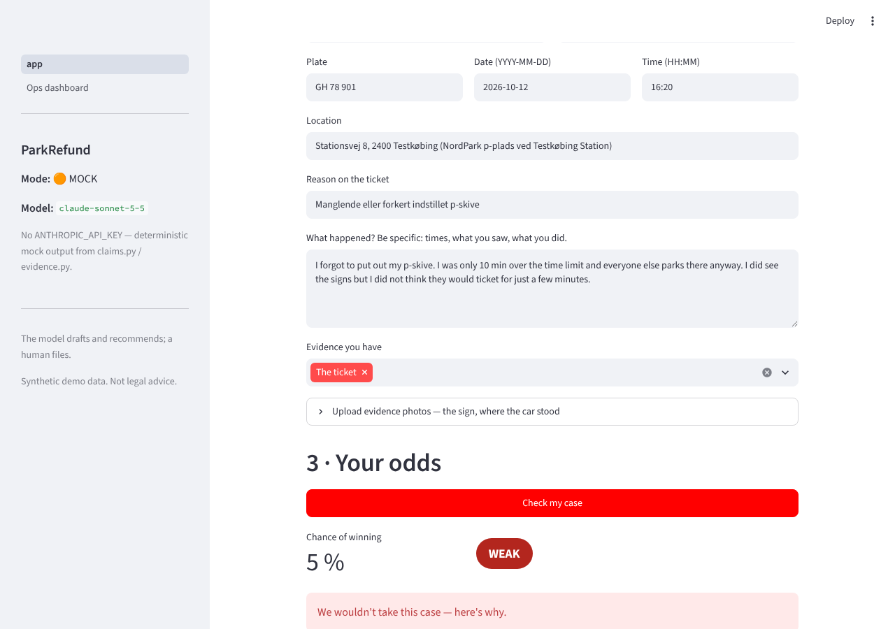
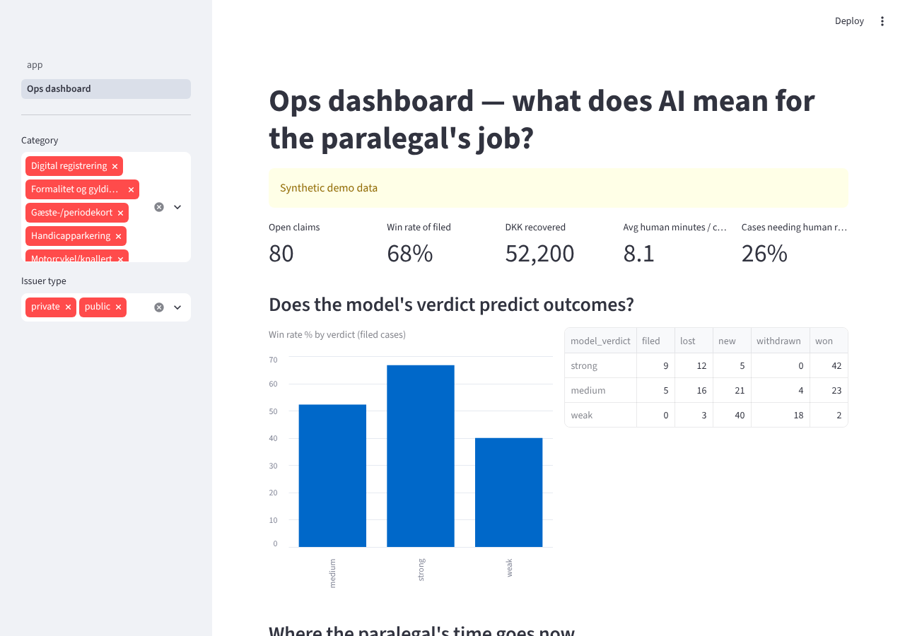

# ParkRefund — the demo, step by step

> **Present from this link:** https://claude.ai/artifact/XQufJwdkuqk9pL2cQx9kQ4 — the same flow as an 8-screen stepper (→ to advance, N for speaker notes). Also on GitHub Pages via `docs/index.html`.

Every image below is a real browser screenshot of the app on `main`, generated by
`demo_walkthrough.py` (mock mode unless a key is present). If you can't run anything, present from
this page. If you can, the same six clicks are in `PITCH.md`.

**Test it in one command** (also regenerates these images):

```bash
.venv/bin/pip install playwright && .venv/bin/playwright install chromium   # once
.venv/bin/python demo_walkthrough.py                                        # mock
PARKREFUND_MODEL=claude-opus-5-5 .venv/bin/python demo_walkthrough.py       # live, with .env
```

Exit code 0 and six files in `demo/` = the whole demo path works.

---

## 1 · Landing — "No win, no fee"



## 2 · Upload the ticket photo → the form fills itself

Claude reads the operator, ticket number, plate, date, amount and reason from the photo.



## 3 · The honest verdict

78 %, **strong**. The ground is *Skiltning* — the regulator's own category. What helps, what hurts,
and exactly which photo to go and take.



## 4 · The appeal letter in Danish, and the payout

A ready-to-send *indsigelse*: ticket number, plate, date, operator, the ground, the attached
evidence, request for annulment. Then the money: 850 back, 30 % fee, 595 to the customer. Nothing
if we lose.



## 5 · The trust moment — we say no

Same flow, the "forgot p-skive" case: 5 %, **weak**, *we wouldn't take this case*. The model says no
when the rulebook says no.



## 6 · The paralegal's new job — the ops dashboard

Every claim triaged and drafted by the model. The human reviews only the 40–60 % band and has the
final say on every filing. Model drafts and recommends; a human files.



---

All data synthetic. Rulebook is a simplified approximation, not legal advice.
